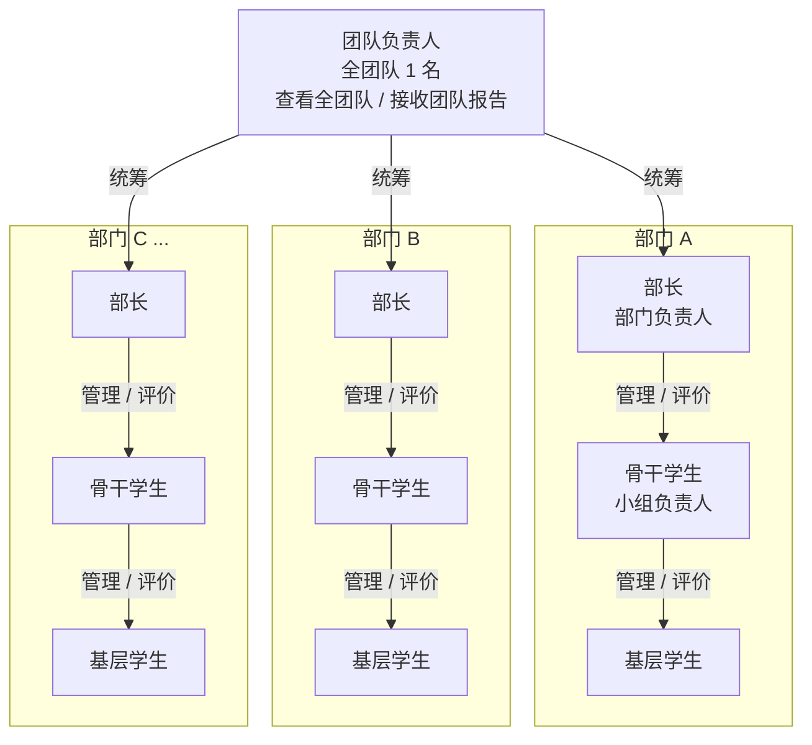
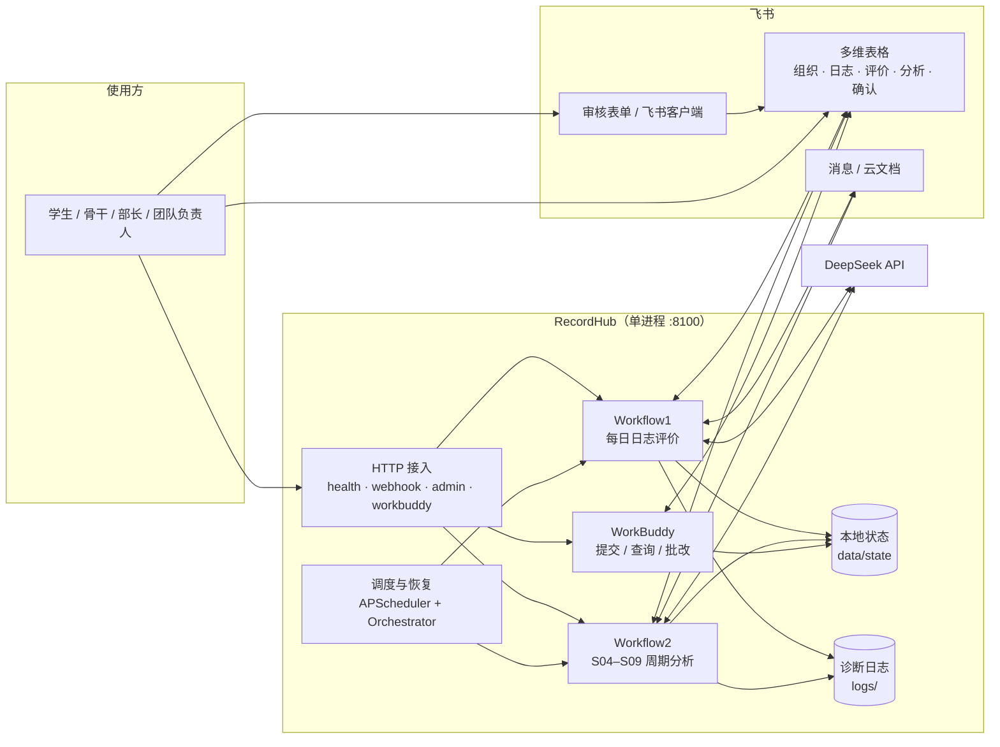
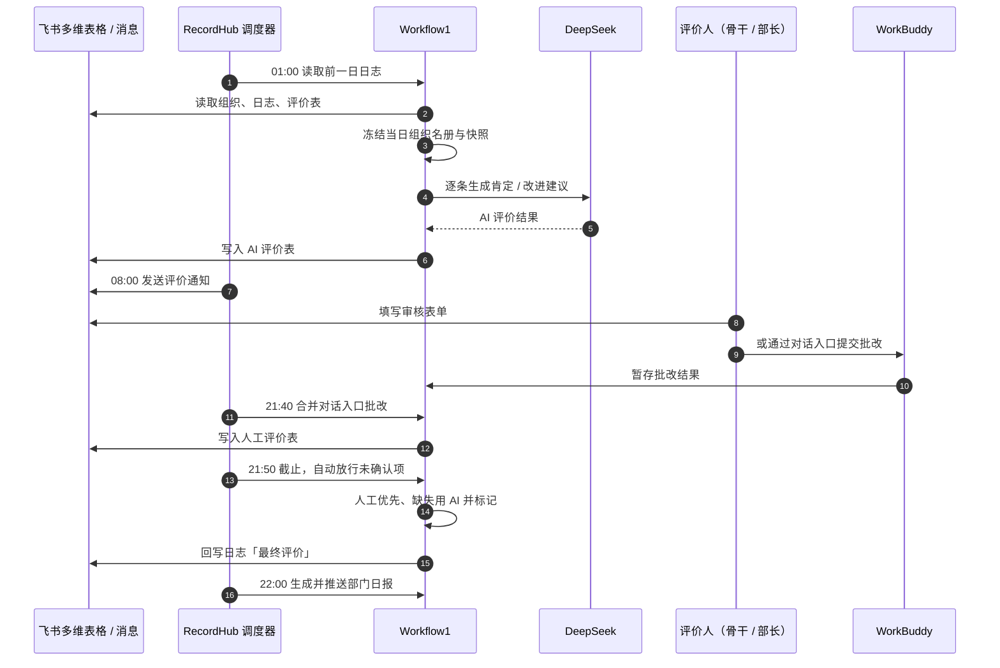
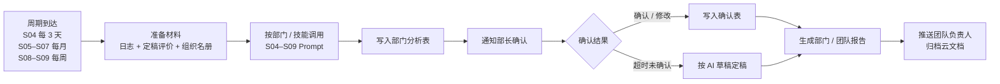
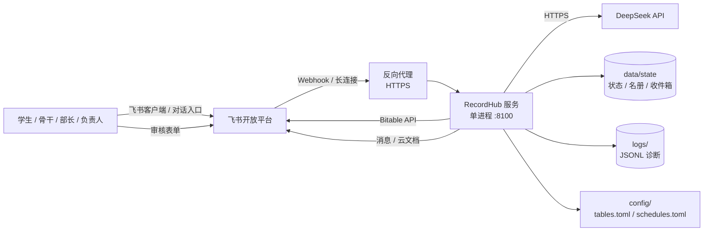
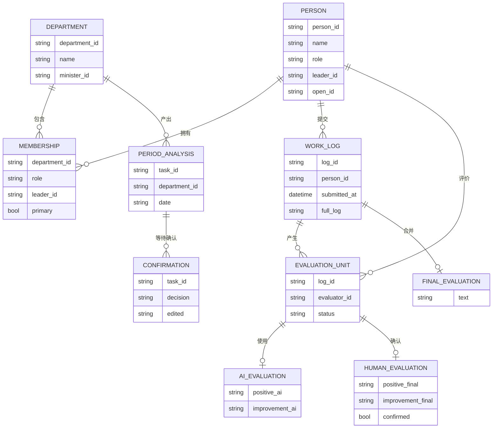

# RecordHub 架构说明

本文用于汇报和评审。图中部门名称使用占位符，汇报时替换为实际部门即可。业务角色与评价关系来自飞书组织表；系统模块与数据流来自当前代码。

## 图片版（可直接用于汇报）

| 图 | 文件 |
| --- | --- |
| 业务组织架构 | [`assets/architecture/01-org-chart.png`](assets/architecture/01-org-chart.png) |
| 系统总体架构 | [`assets/architecture/02-system-overview.png`](assets/architecture/02-system-overview.png) |
| 每日 Workflow1 流程 | [`assets/architecture/03-daily-flow.png`](assets/architecture/03-daily-flow.png) |
| 周期 Workflow2 流程 | [`assets/architecture/04-cycle-flow.png`](assets/architecture/04-cycle-flow.png) |
| 部署拓扑 | [`assets/architecture/05-deployment.png`](assets/architecture/05-deployment.png) |
| 核心数据模型 | [`assets/architecture/06-data-model.png`](assets/architecture/06-data-model.png) |

> 图片由本文的 Mermaid 源码渲染；修改 Mermaid 后重新导出即可。图片中不含真实姓名、手机号等个人信息。

## 一页纸总览

```text
                          ┌──────────────────────────────┐
                          │        团队负责人（1 名）      │
                          │   查看全团队日志 / 接收团队报告  │
                          └───────────────┬──────────────┘
                                          │
              ┌───────────────────────────┼───────────────────────────┐
              │                           │                           │
      ┌───────▼────────┐          ┌───────▼────────┐          ┌───────▼────────┐
      │    部门 A       │          │    部门 B       │          │    部门 C ...   │
      │  部长（1 名）    │          │  部长（1 名）    │          │  部长（1 名）    │
      │      │          │          │      │          │          │      │          │
      │  骨干学生        │          │  骨干学生        │          │  骨干学生        │
      │      │          │          │      │          │          │      │          │
      │  基层学生        │          │  基层学生        │          │  基层学生        │
      └────────────────┘          └────────────────┘          └────────────────┘

评价关系：基层日志 → 骨干评价；骨干日志 → 部长评价；部长确认部门周期结果；
          团队负责人接收全团队汇总。跨部门人员可在多个部门拥有不同角色和直属上级。
```

## 二、业务组织架构



### 角色与权限

| 角色 | 组织位置 | 日志评价 | 查询范围 | 批改 / 确认 |
| --- | --- | --- | --- | --- |
| 团队负责人 | 全团队唯一 | 不参与逐条日志评价 | 全团队 | 接收团队报告 |
| 部长 | 每个部门 1 名 | 评价本部门骨干日志 | 本部门 | 确认本部门周期分析结果 |
| 骨干学生 | 部门内小组负责人 | 评价本组基层日志 | 本人 + 直属下级 | 批改本组日志评价 |
| 基层学生 | 部门内成员 | 提交日志 | 本人 | 无 |

### 组织数据约束

- 每个部门必须有且只有 1 名有效部长。
- 全团队必须有且只有 1 名团队负责人。
- 基层学生的直属上级必须是同部门骨干；骨干学生的直属上级必须是同部门部长。
- 每名非团队负责人必须恰好有 1 条主部门关系。
- 跨部门人员通过 `person_departments` 追加成员关系；同一人在不同部门可以有不同的角色和直属上级。
- 团队负责人不能出现在跨部门附加关系中。
- 同一评价人在不同部门承担不同评价角色时，系统会告警，避免评价口径混用。

## 三、系统分层架构



### 模块职责

| 层 | 模块 | 职责 |
| --- | --- | --- |
| 接入 | `service/api.py` | HTTP 路由、鉴权、生命周期、调度器装配 |
| 接入 | `service/bitable_events.py` | 飞书长连接，记录变更只入队，由工作线程处理 |
| 接入 | `main.py` | 配置自检、启动服务、手工补跑、诊断 |
| 编排 | `service/orchestration.py` | 预约任务、截止时间、失败重试、启动恢复 |
| 应用 | `src/workflow1/` | 读取日志、生成 AI 评价、收集人工确认、合并最终评价、发报告 |
| 应用 | `src/workflow2/` | 准备周期材料、执行 S04–S09、收集部长确认、生成团队报告 |
| 应用 | `service/workbuddy_query/` | 对话入口查询口径与数据范围控制 |
| 应用 | `service/workbuddy_review/` | 对话入口批改暂存与合并 |
| 领域 | `schema/` | 组织、日志、评价、快照、周期运行的 Pydantic 模型 |
| 领域 | `data/` | 原子状态存储、组织缓存、日志/评价仓储 |
| 支撑 | `llm/` | Prompt 仓库、DeepSeek 客户端、重试与错误处理 |
| 支撑 | `tool/` | 飞书、云文档、HTTP、通知、诊断、可观测性 |
| 配置 | `config/` | 环境变量、表映射、调度、日志与保留策略 |

## 四、每日 Workflow1 流程



### 关键规则

- AI 评价按日志生成，每条日志一份，不按评价人重复调用。
- 人工评价按「日志 × 评价人」生成评价单元；同一人在多部门评价同一日志时共用单元。
- 最终评价顺序固定为「首个部门 + 评价人」，重复运行结果稳定。
- 人工已确认的内容优先；缺少人工时使用 AI 并标记「（AI未确认）」。
- AI 接口失败会延后重试；超过重试上限写「AI 评价失败，请人工补评」并告警，不再自动放行。
- 截止后未完成的日期不会被静默删除：3 天告警，7 天清理状态文件并告警。

## 五、周期 Workflow2 流程



### 周期与 Prompt

| 编号 | 内容 | 默认周期 | 材料范围 |
| --- | --- | --- | --- |
| S04 | 阶段工作进展与困难 | 每 3 个完整自然日 | 最近 3 天部门日志原文，不带评价 |
| S05 | 降级 / 奖励 / 退出 / 提拔建议 | 每月 1 日 | 上一自然月 |
| S06 | idea 清单 | 每月 1 日 | 上一自然月 |
| S07 | 学生例会重点人员 | 每月 1 日 | 上一自然月 |
| S08 | 公共技术建议 | 每周一 | 上一自然周 |
| S09 | 公共培训建议 | 每周一 | 上一自然周 |
| S10 | 团队摘要 | 周期报告阶段 | 各部长确认后的部门结果 |

## 六、部署拓扑



### 部署约束

- 必须单进程运行：状态文件、通知队列、日志轮转都按单进程设计。
- 建议 systemd / 宝塔托管，监听 `127.0.0.1:8100`，由反向代理提供 HTTPS。
- 飞书长连接需要服务器能出网访问飞书开放平台。
- 升级前备份 `data/state/` 和 `.env`；发布时用 `RECORDHUB_RELEASE` 标记版本。
- 修改 `config/tables.toml` 或 `config/schedules.toml` 后重启服务生效。

## 七、核心数据模型



## 八、调度时间线（默认配置）

| 时间 | 任务 |
| --- | --- |
| 00:00 | 生成当天预约计划 |
| 00:50 | 刷新组织缓存 |
| 00:55 | 检查待审核的个性化 Prompt |
| 01:00 | Workflow1 读取前一日日志并生成 AI 评价 |
| 03:30 | 清理过期状态、巡检未完成日期 |
| 04:00 | S04 阶段分析（每 3 天） |
| 06:00 | S08 / S09 周度分析（每周一） |
| 08:00 | 发送人工评价通知；S05–S07 月度分析（每月 1 日） |
| 12:00 | 日志提交窗口开放 |
| 21:40 | 对话入口批改截止并合并进飞书表 |
| 21:50 | 人工评价与周期确认截止，自动放行 |
| 22:00 | 推送部门日报 |
| 23:50 | 日志提交窗口关闭 |

## 九、汇报要点

1. **一条链路闭环**：日志提交 → AI 评价 → 人工确认 → 最终评价 → 部门/团队报告。
2. **人和数据分离**：组织关系每天冻结快照，历史重算不受后续人员调动影响。
3. **人工优先**：人工确认内容覆盖 AI；缺失时才用 AI 并明确标记。
4. **可恢复**：每天一个原子状态文件，失败可续跑；预约任务启动时恢复。
5. **权限隔离**：提交、查询、批改、管理员各用独立 Token，对话入口拿不到管理权限。
6. **风险可控**：未完成日期主动告警、超期清理告警；AI 失败保留原文或标记人工补评。
7. **单进程约束**：状态与日志按单进程设计，部署时不能开多个 worker。

## 十、图中占位符说明

- 部门 A / B / C：替换为实际部门名称。
- 部长、骨干学生、基层学生：对应飞书组织表中的「角色」字段。
- 团队负责人：全团队唯一，通常在人员表中单独标记。
- 跨部门人员：在图中可画成同时连接两个部门的虚线，实际由 `person_departments` 表维护。
